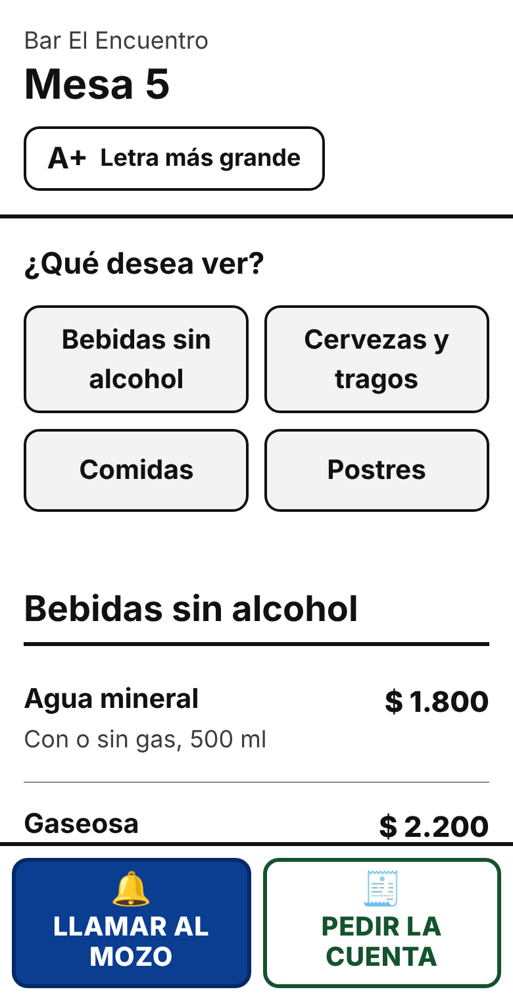
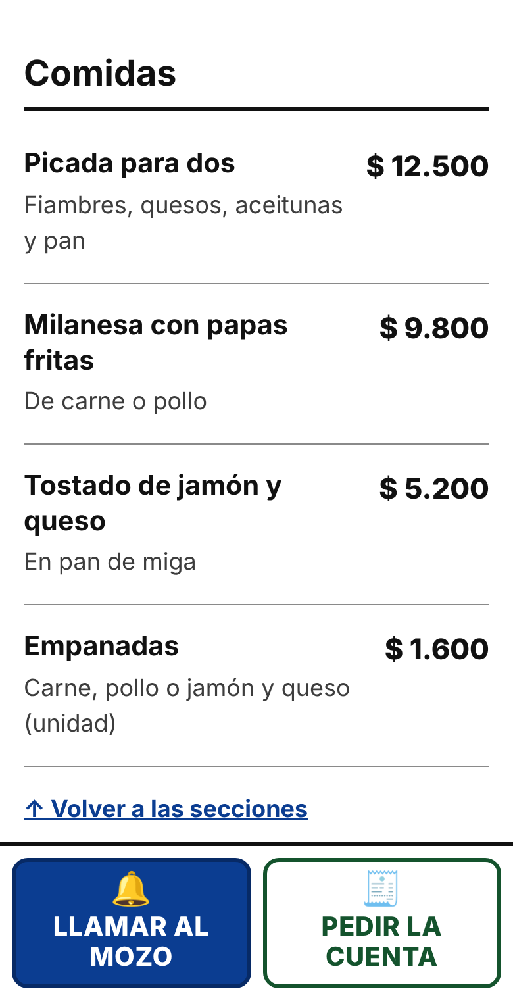
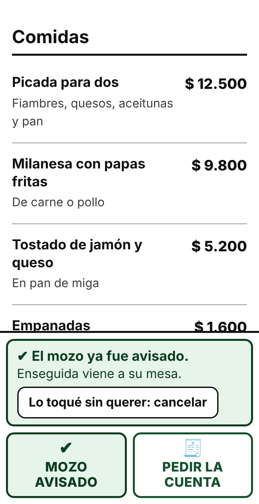
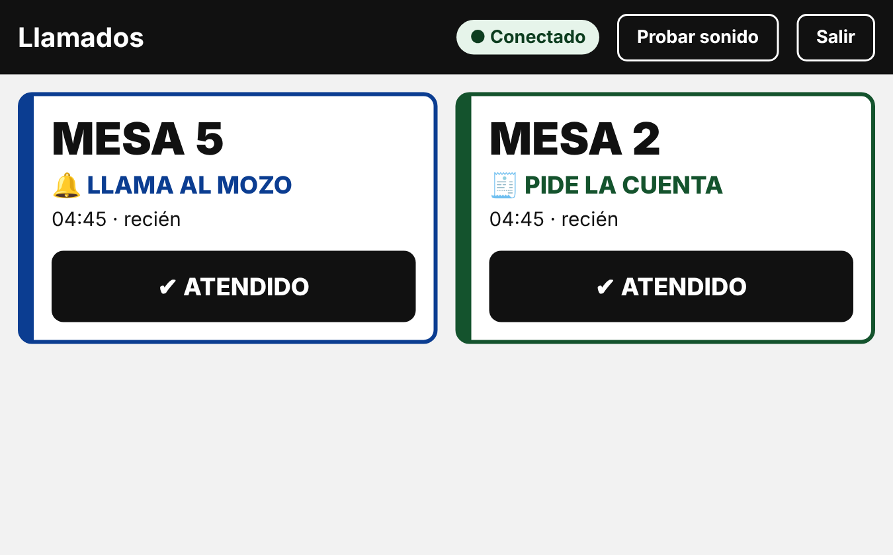
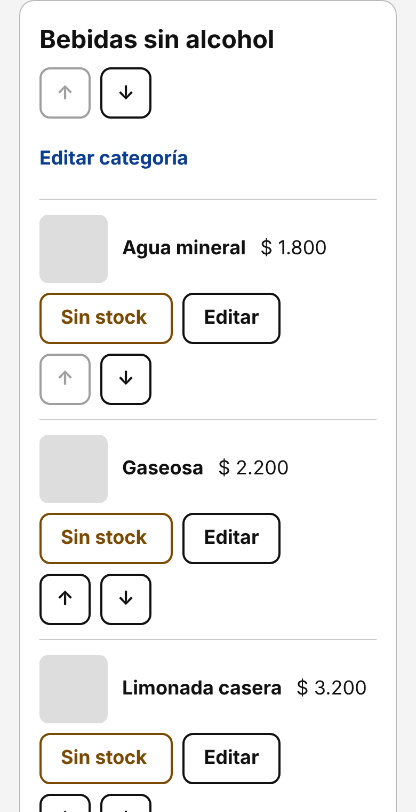
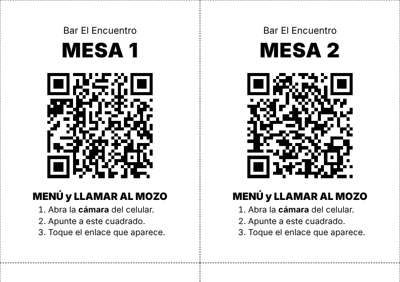

# Menú QR para bares, con botón "Llamar al mozo"

Cada mesa tiene un **código QR**. El cliente lo escanea con la cámara del celular y en segundos ve el menú del bar,
**sin descargar ninguna aplicación ni registrarse**. En la pantalla tiene siempre a mano dos botones grandes:
**LLAMAR AL MOZO** y **PEDIR LA CUENTA**. Los mozos reciben el aviso al instante en una tablet o celular, con sonido.

La aplicación está pensada sobre todo para **personas mayores o con poca experiencia con la tecnología**:
letra grande, colores bien contrastados, botones enormes y nada de ventanas que aparecen de golpe.

<table>
  <tr>
    <td align="center"><br><sub>1. El cliente escanea el QR</sub></td>
    <td align="center"><br><sub>2. Elige una sección y ve los precios</sub></td>
    <td align="center"><br><sub>3. Toca un botón y queda confirmado</sub></td>
  </tr>
</table>

<p align="center">
  <br>
  <sub>4. En la barra, el mozo ve qué mesa lo llama y para qué, y lo marca como atendido</sub>
</p>

---

## Índice

- [¿Cómo funciona?](#cómo-funciona)
- [Las tres pantallas](#las-tres-pantallas)
- [Pensada para personas mayores](#pensada-para-personas-mayores)
- [Probarla en tu computadora](#probarla-en-tu-computadora)
- [Probarla con el celular](#probarla-con-el-celular)
- [Usarla en el bar](#usarla-en-el-bar)
- [Preguntas frecuentes](#preguntas-frecuentes)
- [Para desarrolladores](#para-desarrolladores)

---

## ¿Cómo funciona?

```
   MESA                          SERVIDOR                         BARRA
┌──────────────┐  escanea   ┌──────────────────┐   aviso al   ┌──────────────────┐
│ QR impreso   │──────────▶│  La aplicación   │─────────────▶│ Panel de mozos   │
│ en la mesa   │  el QR     │  (menú, mesas y  │   instante   │ (tablet/celular) │
└──────────────┘            │   llamados)      │              │  🔔 MESA 5       │
       │                    └──────────────────┘              └──────────────────┘
       ▼                             ▲
┌──────────────┐  toca "Llamar       │      ┌──────────────────┐
│ Celular del  │  al mozo"           └──────│ Administración   │
│ cliente      │─────────────────────▶      │ (menú, precios,  │
└──────────────┘                            │  stock y QR)     │
                                            └──────────────────┘
```

1. **El cliente escanea el QR** de su mesa con la cámara. Se abre el menú y la app ya sabe en qué mesa está.
2. **Toca "LLAMAR AL MOZO" o "PEDIR LA CUENTA".** Ve la confirmación "✔ El mozo ya fue avisado".
3. **En la barra suena una alerta** y aparece una tarjeta grande: *MESA 5 · LLAMA AL MOZO · 21:34*.
4. **El mozo va a la mesa y toca "ATENDIDO".** La tarjeta desaparece de todos los paneles.

El encargado del bar carga el menú, cambia precios, marca productos "sin stock" e imprime los QR desde el
**panel de administración**, sin necesidad de saber nada técnico.

---

## Las tres pantallas

### 1. Menú del cliente (se abre con el QR)

- **Sin descargas ni registro:** funciona en el navegador de cualquier celular.
- **Secciones como botones grandes** (Bebidas, Comidas, Postres…): un toque y aparecen los productos.
- Cada producto muestra **nombre, descripción, precio** y foto, si se cargó una.
- Los productos agotados se ven tachados con el aviso **"SIN STOCK"**.
- Los botones **LLAMAR AL MOZO** y **PEDIR LA CUENTA** están **siempre visibles** abajo, en cualquier parte del menú.
- Después de tocar uno:
  - aparece **"✔ El mozo ya fue avisado. Enseguida viene a su mesa."**;
  - el botón queda bloqueado **1 minuto**, para evitar llamados repetidos por accidente;
  - si se tocó sin querer, se puede **cancelar** con el botón "Lo toqué sin querer: cancelar".
- Botón **"Letra más grande"** arriba. El celular lo recuerda para la próxima visita.

### 2. Panel de los mozos (`/personal`)

- Se usa en una **tablet o celular en la barra**. Se entra con un **PIN**.
- Cada llamado aparece como una tarjeta con **número de mesa, qué pide y a qué hora**:
  - azul con 🔔 → **LLAMA AL MOZO**;
  - verde con 🧾 → **PIDE LA CUENTA**.
- **Suena una alerta**, el celular vibra y la tarjeta nueva parpadea unos segundos.
- Si una mesa vuelve a llamar, la tarjeta avisa: **"¡insistió 2 veces!"**.
- Si un llamado lleva **más de 3 minutos sin atender**, la tarjeta se pone **roja** y la alerta vuelve a sonar cada minuto.
- Se pueden tener **varios paneles abiertos** a la vez: lo que se marca como atendido en uno desaparece en todos.
- Arriba se ve si está **"● Conectado"** o **"SIN CONEXIÓN"**. Si se corta, se reconecta solo y no se pierde ningún llamado.

### 3. Administración (`/admin`)



Se entra con una **contraseña**. Desde acá se maneja todo, también desde el celular:

- **Menú:** crear secciones y productos, con nombre, descripción, precio y foto. Las fotos se achican solas para que el menú cargue rápido.
- **Sin stock en un toque:** cuando se acaba algo, se toca **"Sin stock"** y el cliente ve el aviso. Para volver a ofrecerlo, **"Hay stock"**.
- **Ordenar** secciones y productos con las flechas ↑ ↓.
- **Ocultar** un producto o una sección sin borrarlo, por ejemplo los platos de temporada.
- **Mesas:** crear mesas de a una o todas juntas ("de la 1 a la 20") y cambiarles el nombre ("Terraza 3").
- **QR:** descargar el QR de cada mesa o imprimir una hoja A4 con 4 QR listos para recortar, con instrucciones para el cliente.
- **Generar QR nuevo:** si un QR se pierde o alguien se lo lleva, se genera otro y el anterior deja de funcionar.
- **Configuración:** el nombre del bar que aparece arriba del menú.

<br clear="right">

<p align="center"><br><sub>Hoja de QR lista para imprimir</sub></p>

---

## Pensada para personas mayores

El objetivo es que **una persona de 70 años que nunca usó un menú QR pueda ver el menú y llamar al mozo
en menos de 30 segundos, sin ayuda.** Para eso:

| | |
|---|---|
| 🔠 **Letra grande** | 18 px como mínimo y un botón para agrandarla todavía más. También respeta el tamaño de letra que la persona eligió en su celular. |
| 🌓 **Alto contraste** | Texto oscuro sobre fondo blanco y botones de colores fuertes. Cumple la norma de accesibilidad WCAG 2.2 nivel AA. |
| 👆 **Botones enormes** | Los dos botones de llamado, uno al lado del otro, ocupan todo el ancho de la pantalla. Todos los demás miden al menos 48 × 48 px. |
| 💬 **Palabras simples** | "Llamar al mozo", "Pedir la cuenta", "Lo toqué sin querer: cancelar". Ningún ícono va sin texto. |
| 🚫 **Sin sorpresas** | No hay ventanas emergentes, carruseles ni animaciones. La confirmación aparece en el mismo lugar del botón. |
| ✌️ **Pocos toques** | Cualquier información está a 2 toques como máximo. Llamar al mozo lleva **1 toque**. |
| 📶 **Mala señal** | El menú queda guardado en el celular. Si no hay conexión, el llamado se reintenta solo y avisa con claridad si no pudo. |
| 🙋 **Siempre hay un plan B** | Si algo falla, el mensaje indica "levante la mano y el mozo lo atiende". |

---

## Probarla en tu computadora

Necesitás **[Node.js](https://nodejs.org)**: descargá e instalá la versión **LTS**. Después reiniciá la computadora.

### En Windows (con doble clic)

1. Descargá el proyecto: botón verde **Code → Download ZIP** en GitHub.
2. Hacé clic derecho sobre el ZIP → **"Extraer todo…"** → **Extraer**.
3. Entrá a la carpeta y hacé **doble clic en `iniciar-windows`**.
   - Si Windows muestra "Windows protegió su PC", tocá **"Más información" → "Ejecutar de todas formas"**.
   - La primera vez tarda uno o dos minutos: instala lo necesario y carga un **menú de ejemplo con 10 mesas**.
4. Se abre el navegador solo. **No cierres la ventana negra** mientras uses la app.

### En Mac o Linux

```bash
npm install
npm run seed -- 10     # menú de ejemplo y mesas 1 a 10
npm run dev            # abre http://localhost:3000
```

### Direcciones y claves de prueba

| Pantalla | Dirección | Clave |
|---|---|---|
| Administración | http://localhost:3000/admin | `admin-desarrollo` |
| Panel de mozos | http://localhost:3000/personal | PIN `1234` |
| Menú de una mesa | Administración → **Mesas y QR** → "Ver el menú como cliente" | — |

> Estas claves son **solo para probar**. Al publicarla se configuran claves propias (ver [docs/INSTALACION.md](docs/INSTALACION.md)).

**Prueba rápida:** abrí el panel de mozos, tocá "Empezar a recibir llamados". En otra pestaña abrí el menú de la Mesa 1 y tocá
**LLAMAR AL MOZO**. En el panel tiene que sonar la alerta y aparecer "MESA 1".

---

## Probarla con el celular

El celular tiene que estar en el **mismo Wi-Fi** que la computadora.

1. Averiguá la IP de la computadora. En Windows: abrí `cmd`, escribí `ipconfig` y buscá **"Dirección IPv4"** debajo de "Adaptador de LAN inalámbrica Wi-Fi", por ejemplo `192.168.0.15`.
2. En la computadora, abrí la administración **con esa IP** y no con "localhost": `http://192.168.0.15:3000/admin`.
   Así los QR se generan con una dirección que el celular puede abrir.
3. Entrá a **Mesas y QR → Abrir hoja de impresión** y escaneá un QR de la pantalla con la cámara del celular.

**¿El celular no abre la página?** Las causas más comunes son:
- **El firewall de Windows** bloquea la conexión. Ver [cómo permitirla](docs/INSTALACION.md#el-celular-no-abre-la-página).
- **El router no deja que los dispositivos se vean entre sí.** Es común en los routers de fibra de los proveedores, y también en las redes de "invitados".
  Para probar, activá **Compartir Internet** (hotspot) en el celular, conectá la computadora a esa red y repetí desde el paso 1.

---

## Usarla en el bar

Para que funcione con los datos móviles de los clientes y **sin depender de una computadora prendida**, la aplicación
se publica en un **servidor en internet** con un dominio propio, por ejemplo `menu.tubar.com.ar`.

| Qué se necesita | Costo aproximado |
|---|---|
| Un servidor chico (VPS) | USD 4-6 por mes, o gratis con algunas limitaciones |
| Un dominio | USD 10-15 por año, o una dirección gratuita tipo `tubar.duckdns.org` |

Los pasos están en **[docs/INSTALACION.md](docs/INSTALACION.md)**. Después, la puesta en marcha es así:

1. **Cargar el menú real** y el nombre del bar.
2. **Imprimir los QR** recién cuando la dirección sea la definitiva, porque la dirección queda guardada dentro de cada QR.
   - Tamaño mínimo: **6 × 6 cm** (la hoja de impresión ya lo respeta).
   - Conviene plastificarlos o ponerlos en un portacartel, lejos de reflejos de luz.
   - **Escanear cada QR antes de ponerlo** en la mesa y verificar que diga el número correcto.
3. **Dejar el panel de mozos fijo** en una tablet en la barra:
   - siempre **enchufada**, con el **volumen alto** y el **bloqueo automático de pantalla desactivado**;
   - al abrirla, tocar **"Empezar a recibir llamados"** y después **"Probar sonido"**.
4. **Hacer una prueba piloto** con 3 o 4 mesas, mirando cómo la usan los clientes sin ayudarlos.

---

## Preguntas frecuentes

**¿El cliente tiene que descargar algo o registrarse?**
No. Escanea el QR con la cámara y se abre en el navegador del celular.

**¿Qué pasa si el cliente toca el botón muchas veces?**
El mozo recibe **un solo aviso**. Si la mesa vuelve a llamar pasado un minuto sin que nadie la haya atendido,
el panel lo muestra como **"insistió 2 veces"**.

**¿Alguien puede llamar al mozo desde su casa o hacer llamados falsos?**
Cada QR tiene un **código secreto** que no se puede adivinar. Además, la app limita cuántos llamados se
pueden hacer por minuto. Si alguien se lleva un QR, desde la administración se genera uno nuevo y el viejo deja de funcionar.

**¿Qué pasa si el bar tiene mala señal?**
El menú pesa muy poco y queda guardado en el celular, así que abre aunque la conexión sea débil.
Si el llamado no se puede enviar, la app lo reintenta sola durante un minuto y medio y, si no lo logra,
le dice al cliente que levante la mano.

**¿Qué pasa si se corta el Wi-Fi de la tablet de los mozos?**
El panel muestra **"SIN CONEXIÓN"** bien grande, se reconecta solo y recupera todos los llamados pendientes.
Los llamados se guardan en el servidor, así que no se pierden.

**¿Se puede pedir comida o pagar desde el celular?**
Todavía no. Por ahora la app es para ver el menú y llamar al mozo. La aplicación está preparada para
agregar **pedidos desde la mesa, pagos online, programa de fidelización y varias sucursales** más adelante
(ver el [plan por fases](docs/PROPUESTA.md#4-plan-por-fases)).

**¿Cómo cambio la contraseña o el PIN de los mozos?**
En el archivo de configuración `.env` del servidor (`ADMIN_PASSWORD` y `STAFF_PIN`). Conviene cambiar el PIN
cada vez que se va un empleado.

**¿Se pueden perder el menú o los datos?**
Todo se guarda en un único archivo de base de datos. En el servidor se programa una
**copia de seguridad diaria** automática (ver [docs/INSTALACION.md](docs/INSTALACION.md#copias-de-seguridad)).

---

## Para desarrolladores

| | |
|---|---|
| **Servidor** | Node.js 22.13+ (recomendado 24 LTS) con Express 5 |
| **Base de datos** | SQLite incluido en Node.js (`node:sqlite`), con migraciones versionadas |
| **Pantallas** | HTML generado en el servidor, con CSS y JavaScript sin frameworks ni compilación. Todo funciona también sin JavaScript. |
| **Tiempo real** | Server-Sent Events (el servidor envía los llamados al panel por una conexión que mantiene abierta) |
| **Sin conexión** | Service worker que guarda una copia del menú |
| **Seguridad** | Token por mesa, límite de pedidos, protección CSRF, CSP estricta, sesiones firmadas |
| **Dependencias** | 4, todas en JavaScript puro: `express`, `compression`, `multer`, `qrcode` |

```
src/
  server.js          arranque
  app.js             arma la aplicación
  config.js          configuración (.env)
  db.js              base de datos y migraciones
  seed.js            datos de ejemplo
  data/              acceso a datos: menú, mesas, llamados, ajustes
  routes/            rutas: cliente, personal, admin
  views/             HTML de cada pantalla
  lib/               seguridad, tiempo real, formato de precios
public/              estilos, scripts del navegador y service worker
test/                pruebas automáticas
deploy/              Docker + Caddy (HTTPS automático) + copias de seguridad
docs/                documentación
iniciar-windows.bat  iniciador con doble clic para Windows
```

```bash
npm test     # pruebas automáticas
npm run dev  # servidor de desarrollo con recarga automática
```

### Documentación

- **[docs/INSTALACION.md](docs/INSTALACION.md)**: configuración, prueba por internet, publicación en un servidor, copias de seguridad y solución de problemas.
- **[docs/PROPUESTA.md](docs/PROPUESTA.md)**: decisiones técnicas, arquitectura, modelo de datos, plan por fases y riesgos.
