# Cómo funciona la aplicación: guía con capturas

Esta guía recorre **todas las pantallas** de la aplicación, paso a paso, tal como las ven el cliente, los mozos y el encargado del bar.
Las capturas son de la aplicación real con el menú de ejemplo.

Para instalarla o probarla, ver el [README](../README.md#probarla-en-tu-computadora).

- [El recorrido de un llamado, de punta a punta](#el-recorrido-de-un-llamado-de-punta-a-punta)
- [Parte 1 — El cliente](#parte-1--el-cliente)
- [Parte 2 — Los mozos](#parte-2--los-mozos)
- [Parte 3 — El encargado](#parte-3--el-encargado)
- [Reglas que conviene conocer](#reglas-que-conviene-conocer)
- [Qué pasa cuando algo falla](#qué-pasa-cuando-algo-falla)

---

## El recorrido de un llamado, de punta a punta

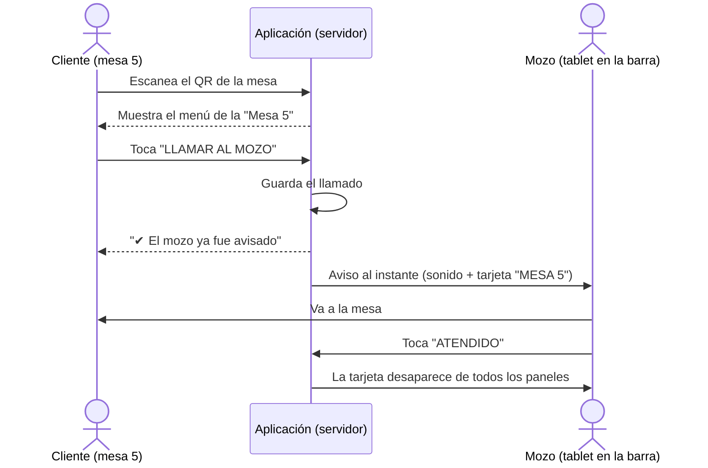

Desde que el cliente toca el botón hasta que suena en la barra pasa **menos de un segundo** (en las pruebas, menos de una décima de segundo).

---

## Parte 1 — El cliente

El cliente **no descarga nada ni se registra**. Solo necesita la cámara del celular.

### Paso 1. Escanea el QR de su mesa

Cada mesa tiene su propio QR. Debajo del código hay instrucciones simples:
*"Abra la cámara del celular. Apunte a este cuadrado. Toque el enlace que aparece."*

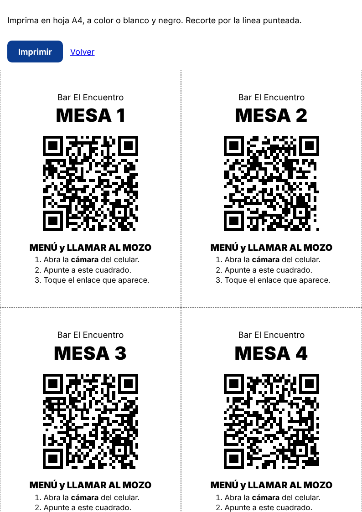

### Paso 2. Se abre el menú de su mesa

<table>
<tr>
<td width="260">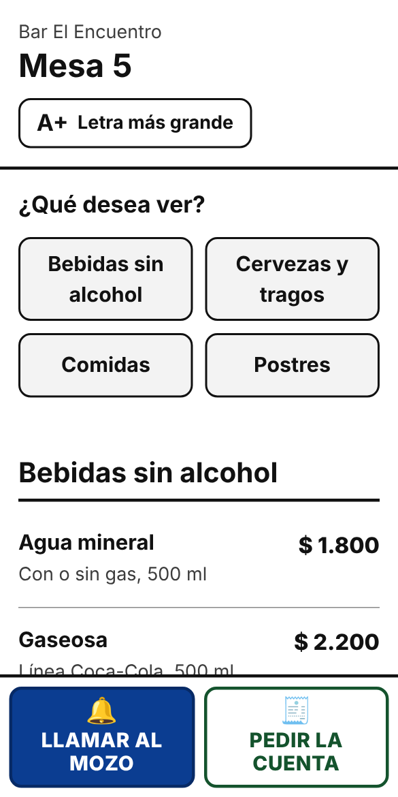</td>
<td>

La app **ya sabe en qué mesa está**: arriba dice **"Mesa 5"**.

- **"¿Qué desea ver?"** muestra las secciones del menú como botones grandes.
- Abajo, **siempre visibles**, están los dos botones principales:
  - **🔔 LLAMAR AL MOZO**
  - **🧾 PEDIR LA CUENTA**
- Arriba a la derecha está el botón **"A+ Letra más grande"**.

</td>
</tr>
</table>

### Paso 3. Toca una sección y ve los productos

<table>
<tr>
<td width="260">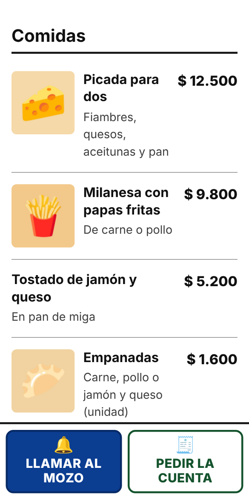</td>
<td>

Con **un toque** en "Comidas" la pantalla baja hasta esa sección.

Cada producto muestra:
- **nombre**, en negrita;
- **descripción corta**;
- **precio**, grande y a la derecha;
- **foto**, si el encargado cargó una.

Al final de cada sección hay un enlace **"↑ Volver a las secciones"**.

</td>
</tr>
</table>

### Productos sin stock

<table>
<tr>
<td width="260">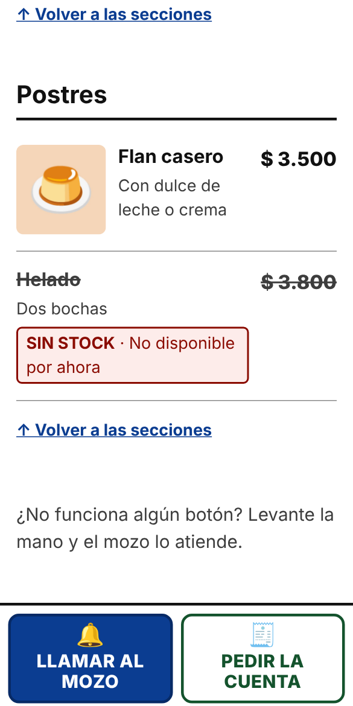</td>
<td>

Cuando algo se acaba, el encargado lo marca con un toque y el cliente lo ve **tachado** con el aviso:

> **SIN STOCK** · No disponible por ahora

El producto no desaparece, así el cliente sabe que existe y que hoy no hay.

Al final del menú siempre hay un plan B: *"¿No funciona algún botón? Levante la mano y el mozo lo atiende."*

</td>
</tr>
</table>

### Letra más grande

<table>
<tr>
<td width="260">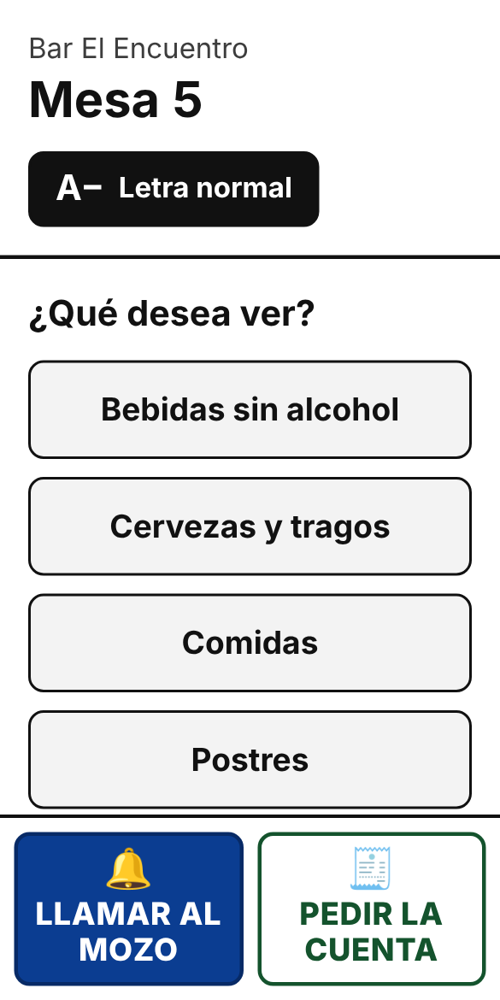</td>
<td>

El botón **"A+ Letra más grande"** agranda todo el texto y los botones.
Para volver atrás, el mismo botón pasa a decir **"A− Letra normal"**.

El celular **lo recuerda**: si el cliente vuelve otro día, el menú ya se abre con letra grande.

</td>
</tr>
</table>

### Paso 4. Llama al mozo

<table>
<tr>
<td width="260">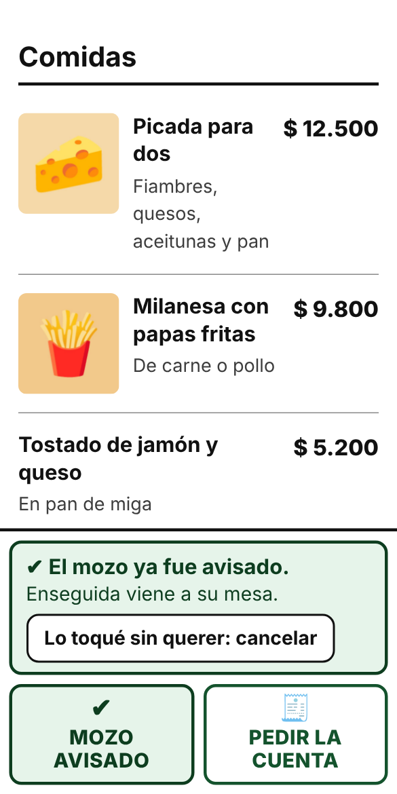</td>
<td>

Con **un solo toque** en **LLAMAR AL MOZO**:

1. Aparece la confirmación **"✔ El mozo ya fue avisado. Enseguida viene a su mesa."**
2. El botón cambia a **"✔ MOZO AVISADO"** y queda bloqueado **1 minuto**, para evitar llamados repetidos.
3. Si lo tocó sin querer, puede tocar **"Lo toqué sin querer: cancelar"**.

La confirmación aparece en la parte de abajo de la pantalla, **sin ventanas emergentes**, y se oculta sola a los 30 segundos.
El botón sigue indicando "MOZO AVISADO" mientras dura el bloqueo.

</td>
</tr>
</table>

### Pedir la cuenta

<table>
<tr>
<td width="260">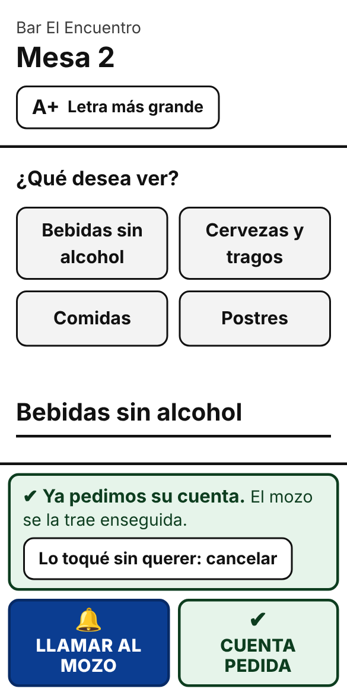</td>
<td>

Funciona igual que llamar al mozo:

> **✔ Ya pedimos su cuenta.** El mozo se la trae enseguida.

En el panel de los mozos aparece en **verde** y con otro sonido, para distinguirlo de un llamado común.

</td>
</tr>
</table>

### Cancelar un llamado hecho por error

<table>
<tr>
<td width="260">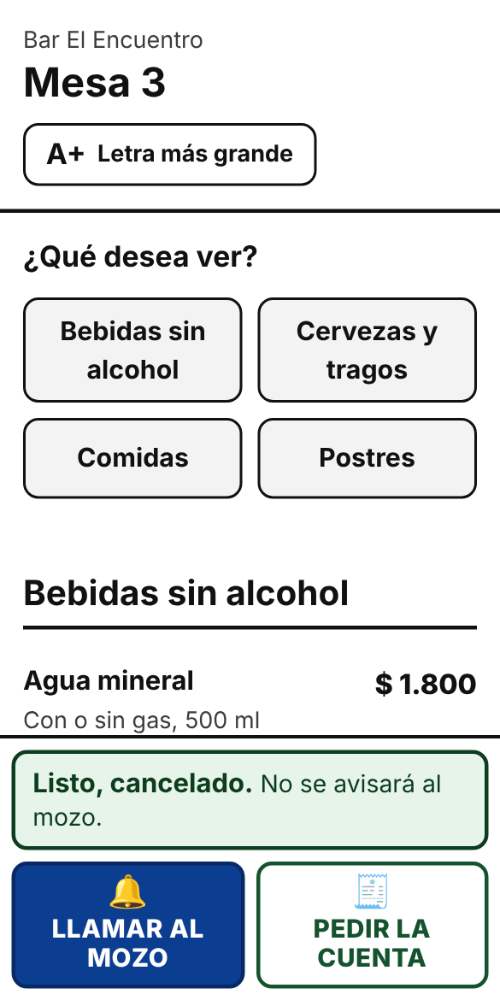</td>
<td>

Después de tocar **"Lo toqué sin querer: cancelar"**:

> **Listo, cancelado.** No se avisará al mozo.

El llamado **desaparece del panel de los mozos** y el botón vuelve a estar disponible.

</td>
</tr>
</table>

### Si se corta internet

<table>
<tr>
<td width="260">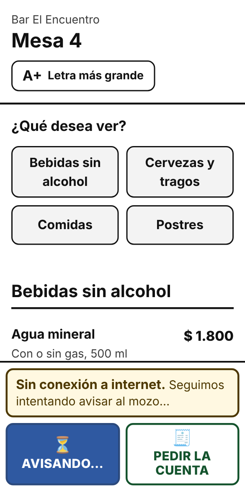</td>
<td>

Si el celular pierde la conexión justo al llamar, la app **no le miente al cliente**: no muestra "avisado" hasta que el aviso llega de verdad.

> **Sin conexión a internet.** Seguimos intentando avisar al mozo…

Reintenta sola durante un minuto y medio. Si no lo logra, le dice al cliente que **levante la mano**.

El menú, en cambio, **se puede seguir viendo**: queda guardado en el celular desde la primera vez que se abrió.

</td>
</tr>
</table>

### QR viejo o inválido

<table>
<tr>
<td width="260">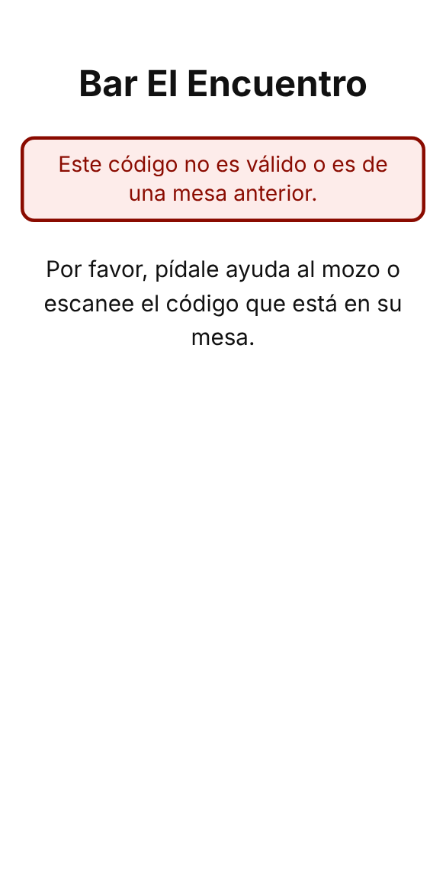</td>
<td>

Si alguien usa un QR que ya no funciona (por ejemplo, uno que el encargado reemplazó) o una dirección inventada, ve:

> Este código no es válido o es de una mesa anterior.
> Por favor, pídale ayuda al mozo o escanee el código que está en su mesa.

Así **nadie puede llamar al mozo desde afuera** del bar ni hacerse pasar por otra mesa.

</td>
</tr>
</table>

---

## Parte 2 — Los mozos

El panel se usa en una **tablet o celular fijo en la barra**. Se pueden tener varios abiertos a la vez.

### Paso 1. Ingresar con el PIN

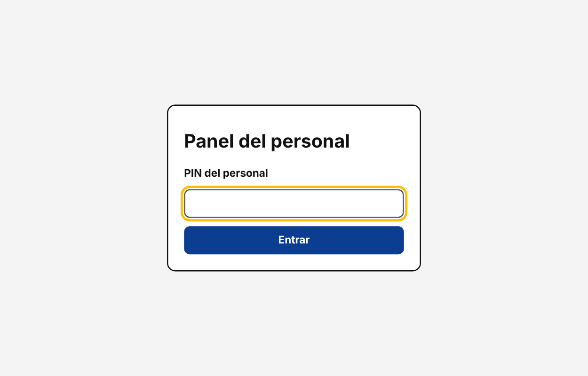

En `/personal` se ingresa el **PIN del personal**. La sesión dura **30 días**, así que la tablet de la barra no pide el PIN todos los días.

### Paso 2. "Empezar a recibir llamados"

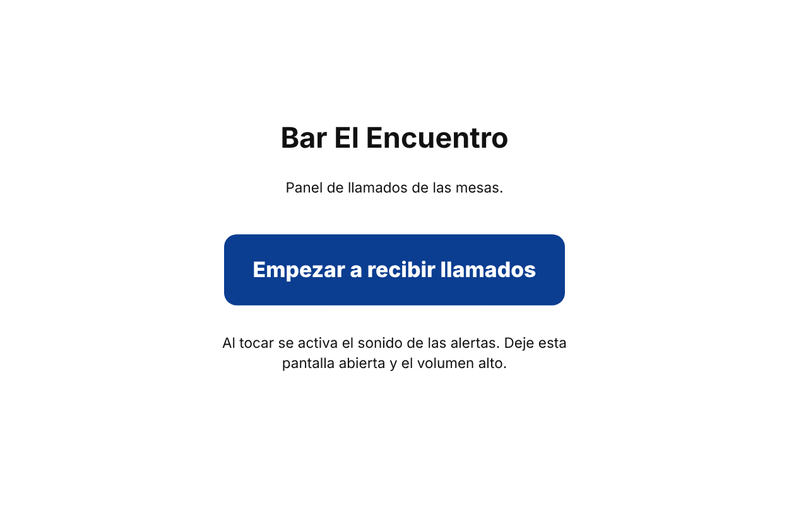

Este toque es **obligatorio**. Los navegadores no dejan reproducir sonido hasta que la persona toca la pantalla,
y este botón **activa las alertas sonoras**. También mantiene la pantalla encendida.

### Paso 3. Esperar los llamados

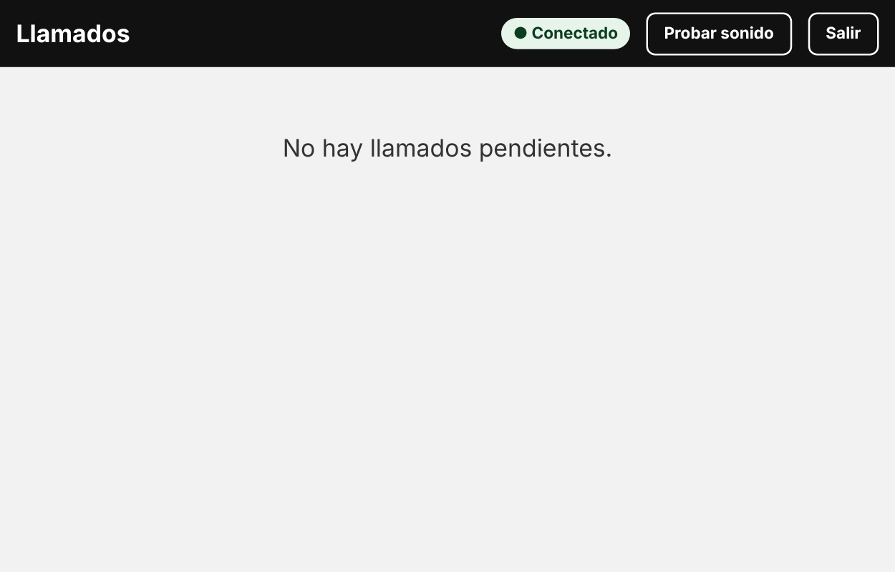

Arriba se ve el estado de la conexión (**● Conectado**) y un botón **"Probar sonido"** para comprobar el volumen.

### Paso 4. Llega un llamado

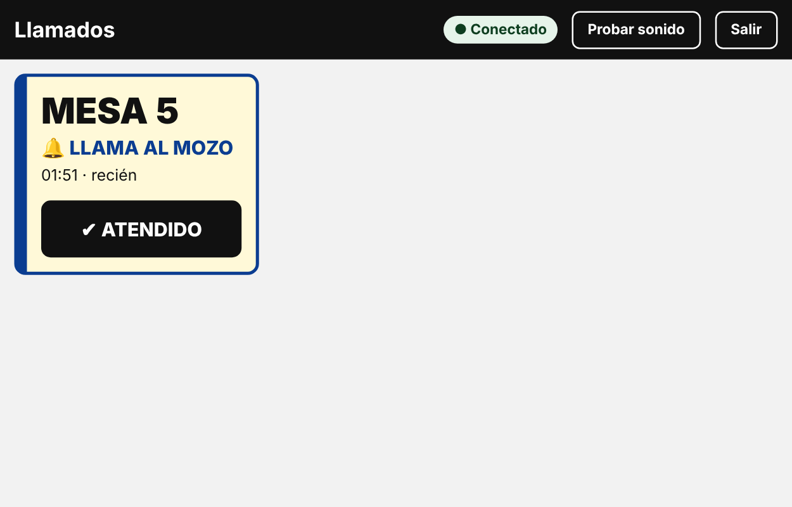

Cuando una mesa llama:
- **suena una alerta**, el dispositivo **vibra** y la tarjeta nueva **parpadea** unos segundos;
- la tarjeta muestra **el número de mesa** bien grande, **qué pide** y **a qué hora**.

Al llegar a la mesa, el mozo toca **"✔ ATENDIDO"** y la tarjeta desaparece **de todos los paneles**.

### Varios llamados a la vez

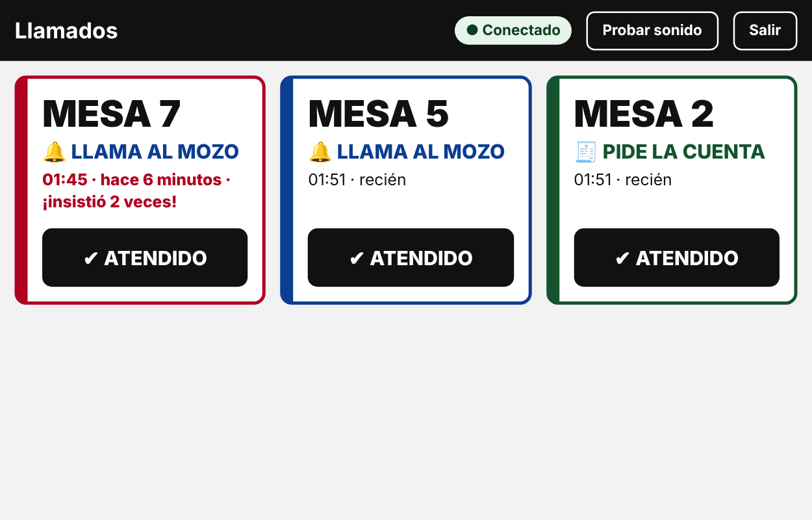

| Color | Significa |
|---|---|
| 🔵 **Azul** con 🔔 | **LLAMA AL MOZO** |
| 🟢 **Verde** con 🧾 | **PIDE LA CUENTA** |
| 🔴 **Rojo** | Lleva **más de 3 minutos sin atender**. La alerta vuelve a sonar cada minuto hasta que alguien lo atiende. |

Los llamados se ordenan del **más antiguo al más nuevo**, así el que más espera está siempre primero.
Si la mesa volvió a tocar el botón mientras esperaba, la tarjeta lo dice: **"¡insistió 2 veces!"**.

### Si se corta la conexión

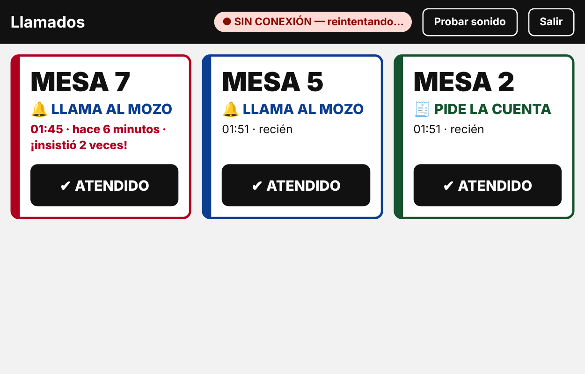

Arriba aparece **"● SIN CONEXIÓN — reintentando…"** en rojo. El panel **se reconecta solo** y, al volver,
recupera **todos** los llamados que llegaron mientras estaba desconectado, con su sonido. Ningún llamado se pierde,
porque se guardan en el servidor.

---

## Parte 3 — El encargado

La administración funciona en la computadora y también en el celular. Se entra en `/admin` con la **contraseña de administración**.

### Ingreso

<table>
<tr>
<td width="260">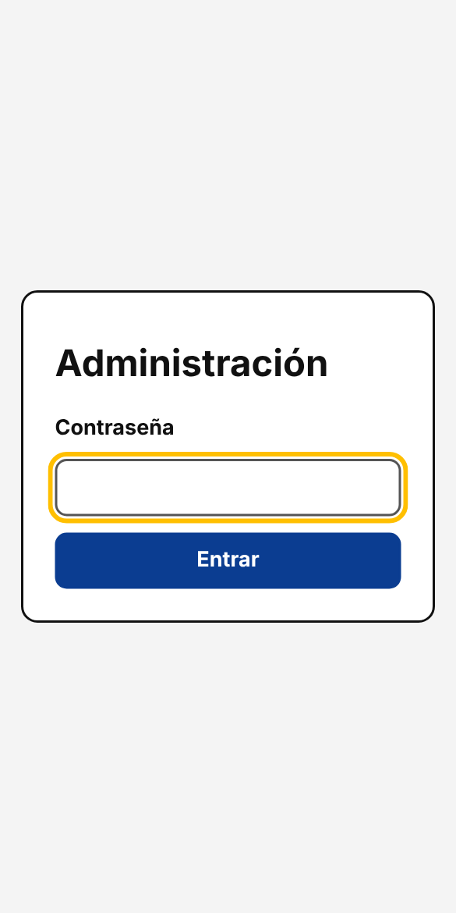</td>
<td>

Arriba de cada pantalla hay un menú con las secciones:
**Menú · Mesas y QR · Configuración · Panel de mozos · Salir**.

Por seguridad, la sesión dura 12 horas y se bloquea por 15 minutos después de 10 intentos fallidos.

</td>
</tr>
</table>

### Menú: agregar secciones y productos

<table>
<tr>
<td width="260">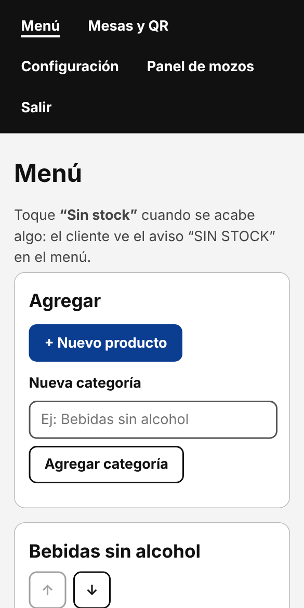</td>
<td>

- **"+ Nuevo producto"** abre el formulario de producto.
- **"Nueva categoría"** crea una sección del menú, por ejemplo "Bebidas sin alcohol" o "Promociones".
- Cada sección tiene **"Editar categoría"**, para cambiarle el nombre, ocultarla del menú o borrarla.

</td>
</tr>
</table>

### Menú: stock, edición y orden

<table>
<tr>
<td width="260">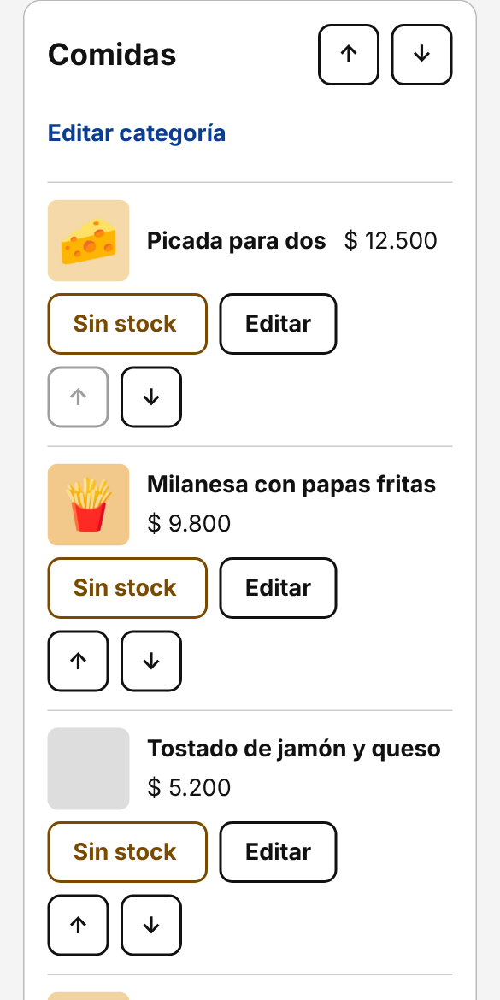</td>
<td>

Cada producto tiene tres controles:

- **"Sin stock"**: se toca cuando se acaba algo. El cliente lo ve tachado al abrir o recargar el menú. Para volver a ofrecerlo, el botón pasa a decir **"Hay stock"**.
- **"Editar"**: cambia nombre, precio, descripción o foto.
- **↑ ↓**: sube o baja el producto en el menú.

</td>
</tr>
</table>

### Editar un producto

<table>
<tr>
<td width="260">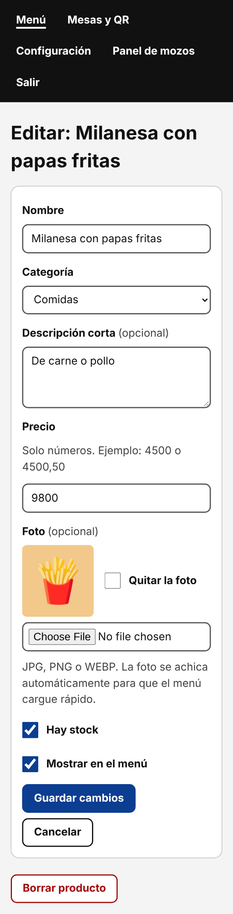</td>
<td>

| Campo | Cómo se completa |
|---|---|
| **Nombre** | Como aparece en el menú |
| **Categoría** | La sección donde va |
| **Descripción corta** | Opcional, hasta 200 letras |
| **Precio** | Solo números: `9800` o `9800,50` |
| **Foto** | Opcional. Se puede sacar con el celular en el momento: la app la achica sola para que el menú cargue rápido. |
| **Hay stock** | Si está desmarcado, aparece "SIN STOCK" |
| **Mostrar en el menú** | Si está desmarcado, el producto se oculta sin borrarse. Sirve para platos de temporada. |

Abajo está **"Borrar producto"**, que pide confirmación antes de borrar.

</td>
</tr>
</table>

### Mesas y QR

<table>
<tr>
<td width="260">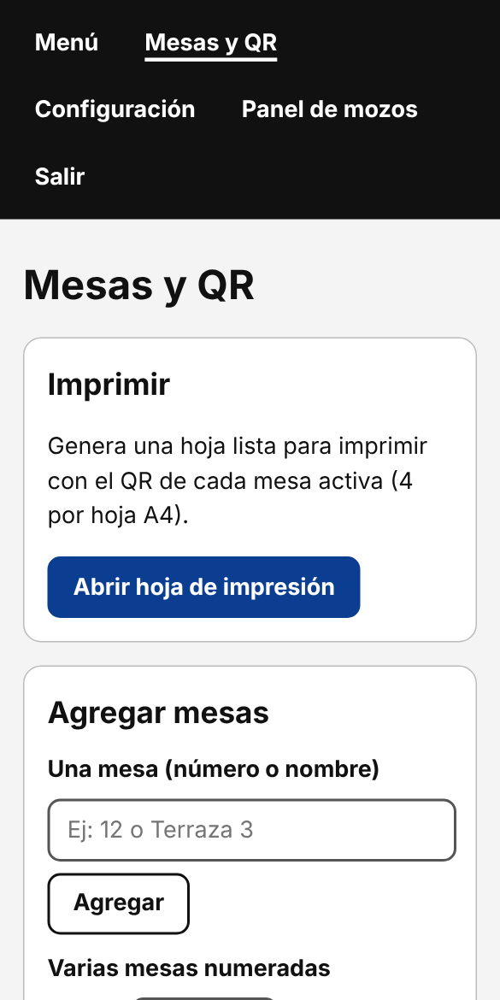</td>
<td>

- **Agregar mesas**: de a una ("12", "Terraza 3") o varias juntas ("desde 1 hasta 20").
- **"Abrir hoja de impresión"**: genera la hoja A4 con 4 QR por página (ver el [Paso 1 del cliente](#paso-1-escanea-el-qr-de-su-mesa)).

Cada mesa de la lista tiene:
- **"Ver el menú como cliente"**, para revisar cómo lo ve un cliente;
- **"Descargar QR"**, una imagen grande para mandar a una imprenta;
- **"Generar QR nuevo"**, si el QR se perdió o alguien se lo llevó: **el anterior deja de funcionar** y hay que imprimir el nuevo;
- **"Desactivar"**, para una mesa que no se usa por un tiempo.

</td>
</tr>
</table>

### Configuración

<table>
<tr>
<td width="260">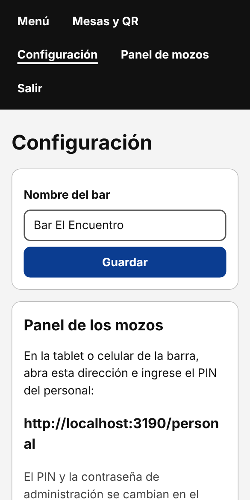</td>
<td>

- **Nombre del bar**: es el que aparece arriba del menú y en los QR impresos.
- **Panel de los mozos**: muestra la dirección que hay que abrir en la tablet de la barra.

</td>
</tr>
</table>

---

## Reglas que conviene conocer

| Regla | Valor | Para qué sirve |
|---|---|---|
| Bloqueo después de llamar | **1 minuto** | Evita que el mozo reciba varios avisos por el mismo llamado. |
| Insistencia | Si la mesa vuelve a llamar **pasado 1 minuto** sin ser atendida | El panel muestra "¡insistió 2 veces!" y vuelve a sonar. |
| Llamado demorado | **3 minutos** sin atender | La tarjeta se pone roja y la alerta suena cada minuto. |
| Llamados olvidados | **6 horas** | Se cierran solos, para que el panel no amanezca lleno al día siguiente. |
| Historial de llamados | **90 días** | Se guarda para futuras estadísticas y después se borra solo. |
| Límite por celular | **12 acciones por minuto** | Frena abusos o pruebas automatizadas. |
| Sesión de mozos | **30 días** | La tablet de la barra no pide el PIN todos los días. |
| Sesión de administración | **12 horas** | Más corta, porque permite cambiar todo. |
| Intentos de clave o PIN | **10 cada 15 minutos** | Impide adivinar la clave probando muchas veces. |
| Fotos | Hasta **3 MB**, se achican a **800 px** | El menú sigue cargando rápido con mala señal. |

El tiempo de bloqueo se puede cambiar con `CALL_COOLDOWN_SECONDS` (ver [INSTALACION.md](INSTALACION.md#2-configuración-env)).

---

## Qué pasa cuando algo falla

| Situación | Qué hace la app |
|---|---|
| El cliente tiene mala señal | El menú se abre desde la copia guardada en el celular. El llamado se reintenta solo durante 90 segundos. |
| El cliente no tiene internet | Le avisa "Sin conexión a internet" y, si no logra enviar el llamado, le pide que levante la mano. |
| El celular del cliente es muy viejo | El menú y los botones funcionan igual, como una página web simple. |
| Se corta el Wi-Fi de la tablet de los mozos | Muestra "SIN CONEXIÓN" en rojo, se reconecta sola y recupera todos los llamados pendientes. |
| Dos mozos tocan "ATENDIDO" a la vez | No pasa nada raro: el llamado se cierra una sola vez y desaparece de los dos paneles. |
| Alguien se lleva un QR | El encargado toca "Generar QR nuevo" y el viejo deja de funcionar. |
| Alguien intenta inventar la dirección de otra mesa | No puede: cada QR tiene un código secreto imposible de adivinar. |
| Se reinicia el servidor | No se pierde nada: menú, mesas y llamados están guardados en la base de datos. |
