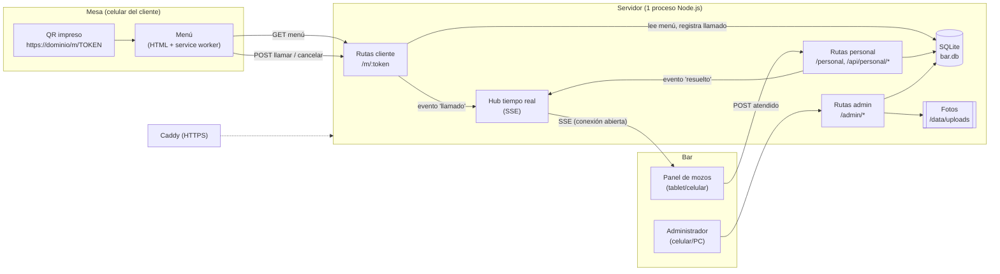
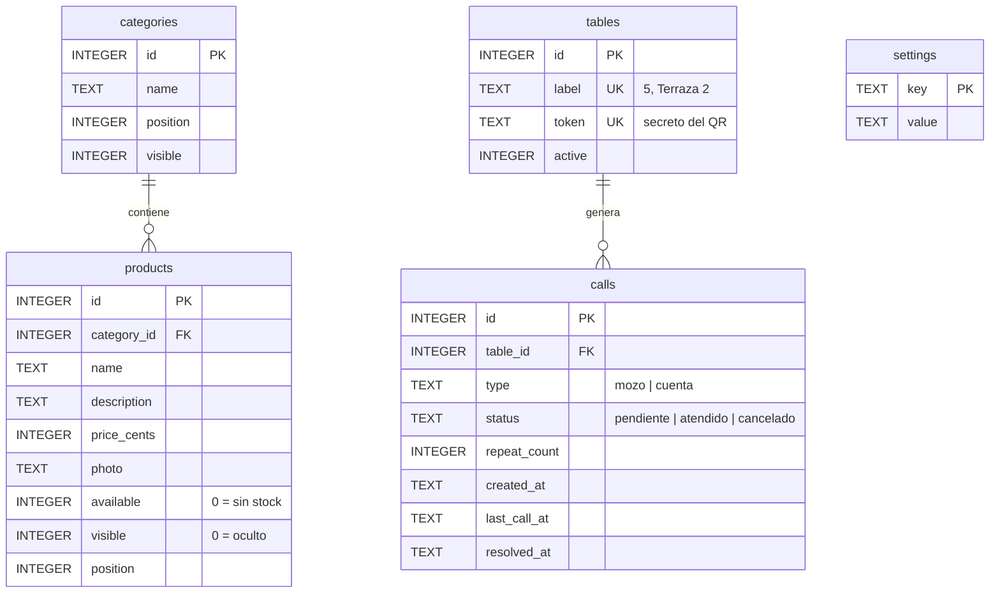

# Propuesta técnica — Menú QR con llamado al mozo

Este documento cubre: decisiones, stack, arquitectura, modelo de datos, plan por fases y riesgos.
La instalación y el uso diario están en el [README](../README.md).

---

## 0. Decisiones tomadas (en lugar de preguntas)

No hizo falta frenar el proyecto con preguntas. Donde faltaba un dato, tomé una decisión razonable y la dejé configurable:

| Tema | Decisión | Dónde se cambia |
|---|---|---|
| Nombre del bar | Variable `BAR_NAME`, editable desde el panel | Panel → Configuración |
| Cantidad de mesas | Ilimitada; se crean de a una o por rango ("de la 1 a la 20") | Panel → Mesas y QR |
| Moneda / formato | Pesos argentinos (`ARS`, `es-AR`): "$ 4.500" | `.env` → `CURRENCY`, `LOCALE` |
| Bloqueo entre llamados | 60 segundos | `.env` → `CALL_COOLDOWN_SECONDS` |
| Acceso del personal | Un PIN compartido (no usuarios individuales) | `.env` → `STAFF_PIN` |
| Hosting | Un VPS chico con Docker + Caddy (HTTPS automático) | `deploy/` |

**Única pregunta que sí conviene confirmar antes de imprimir los QR:** el **dominio** definitivo (por ejemplo `menu.mibar.com`).
Los QR impresos contienen esa dirección; cambiarla después obliga a reimprimir.

---

## 1. Stack tecnológico

| Pieza | Elección | Por qué |
|---|---|---|
| Servidor | **Node.js 22 + Express 5** | Ecosistema enorme, fácil de contratar quien lo mantenga, un solo lenguaje (JavaScript) en servidor y navegador. |
| Base de datos | **SQLite** (`better-sqlite3`) | Un único archivo, cero administración, rapidísima para este volumen (decenas de mesas, cientos de llamados por noche). Backup = copiar un archivo. Se migra a PostgreSQL si algún día hay multi-sucursal. |
| Páginas | **HTML generado en el servidor** + CSS y JS "a mano" (sin React ni compilación) | El menú pesa **~7 KB** comprimido y se ve aunque el JavaScript falle. Ideal para celulares de gama baja y 4G débil. Sin paso de build = menos cosas que se rompen. |
| Tiempo real | **Server-Sent Events (SSE)** | La comunicación es en un solo sentido (servidor → panel de mozos). SSE es HTTP común: reconexión automática incluida, atraviesa proxys, sin librerías. WebSockets sería más complejo sin beneficio aquí. Latencia medida: **~60-80 ms**. |
| QR | `qrcode` | Genera PNG y la hoja A4 lista para imprimir desde el propio panel. |
| Fotos | `multer` + achicado en el navegador del administrador | Las fotos se reducen a 800 px antes de subir: el menú sigue cargando rápido. Se valida el tipo real del archivo. |
| Seguridad | Código propio, sin dependencias | Cookies firmadas (HMAC), limitador de pedidos, CSP estricta, protección CSRF. Poco código, fácil de auditar. |
| Conexión inestable | **Service worker** | Guarda una copia del menú: abre aunque la señal sea mala. Los llamados reintentan solos. |
| HTTPS / proxy | **Caddy** | Certificado HTTPS gratis y automático (Let's Encrypt), una config de 6 líneas. |
| Infraestructura | VPS de 1 vCPU / 1 GB (≈ USD 5-6/mes) + dominio (≈ USD 10-15/año) | Sobra capacidad. Ver alternativas en el README. |

Total de dependencias de producción: **5**.

---

## 2. Arquitectura



### Flujo de un llamado

1. El cliente toca **LLAMAR AL MOZO** → `POST /m/<token>/llamar {tipo: "mozo"}`.
2. El servidor valida el token (identifica la mesa) y el límite de pedidos.
3. En una transacción: si ya hay un llamado pendiente del mismo tipo **hace menos de 60 s**, no hace nada (evita duplicados); si pasó más tiempo, lo cuenta como **insistencia** (`repeat_count + 1`) y vuelve a avisar; si no hay, crea uno nuevo.
4. El hub SSE envía el evento `llamado` a todos los paneles conectados → suena la alerta y aparece la tarjeta.
5. El celular del cliente muestra "✔ El mozo ya fue avisado" y bloquea el botón 60 s (con opción de **cancelar** si lo tocó sin querer).
6. El mozo toca **ATENDIDO** → evento `resuelto` → la tarjeta desaparece de todos los paneles.

Si el panel pierde la conexión, el navegador se reconecta solo y el servidor le reenvía la lista completa de pendientes (`snapshot`): **ningún llamado se pierde**, porque viven en la base de datos, no solo en memoria.

### Estructura del código

```
src/
  server.js            arranque y cierre ordenado
  app.js               arma la aplicación (middlewares, rutas, limpieza periódica)
  config.js            variables de entorno, con validación en producción
  db.js                conexión SQLite + migraciones versionadas
  seed.js              menú de ejemplo + mesas
  data/                acceso a datos (un archivo por entidad)
  lib/security.js      sesiones, limitador, cabeceras, CSRF
  lib/realtime.js      hub SSE
  lib/format.js        escape HTML, plantillas, precios
  routes/              cliente, personal, admin
  views/               HTML de cada pantalla
public/
  css/ js/ sw.js       estilos, scripts y service worker
test/app.test.js       pruebas de integración (npm test)
deploy/                Docker Compose + Caddy + backup
```

### Cómo crece sin reescribirse

- **Pedidos desde la mesa:** nueva tabla `orders` + `order_items` (referencian `tables` y `products`); el hub SSE ya existe para avisar a cocina/barra con un nuevo tipo de evento.
- **Pagos online:** tabla `payments` vinculada a `orders`; integración con Mercado Pago / Stripe en un módulo `routes/pagos.js`. El token por mesa ya identifica la cuenta.
- **Fidelización:** tabla `customers` opcional; el flujo actual sigue sin login.
- **Multi-sucursal:** tabla `branches` y columna `branch_id` en `categories`, `products`, `tables`, `calls` (una migración). El hub SSE filtra por sucursal. En ese punto conviene pasar a PostgreSQL y, si hay varios servidores, Redis para el pub/sub del tiempo real.
- Las migraciones (`src/db.js`) están versionadas: se agregan sin tocar las anteriores.

---

## 3. Modelo de datos



Notas:
- Los precios se guardan en **centavos (entero)** para evitar errores de redondeo.
- `available` (sin stock) y `visible` (oculto) son distintos: un producto agotado se sigue mostrando con el aviso "SIN STOCK"; uno oculto no aparece.
- El **token** de la mesa (96 bits aleatorios) es lo que impide que alguien adivine la dirección de otra mesa. Regenerarlo invalida el QR viejo.
- El historial de llamados se conserva 90 días (sirve para medir tiempos de atención en una fase futura). Los pendientes olvidados más de 6 h se cierran solos.

---

## 4. Plan por fases

### Fase 1 — MVP (este entregable)
- Menú por QR sin login, mesa identificada automáticamente.
- Categorías, productos con foto opcional, precios, "sin stock".
- Botones fijos **LLAMAR AL MOZO** y **PEDIR LA CUENTA**, confirmación clara, bloqueo de 60 s, cancelar por error.
- Botón "Letra más grande" (se recuerda en el celular).
- Panel de mozos en tiempo real con sonido, vibración, parpadeo, aviso de demora y de "insistencia".
- Administración: menú, stock en un toque, mesas, QR en PNG y hoja A4 para imprimir.
- Seguridad: token por mesa, límite de pedidos, CSRF, CSP, sesiones firmadas.
- Funciona con mala conexión (copia del menú + reintentos).
- Pruebas automáticas, Docker, HTTPS, backups.

**Antes de abrir al público (1 semana):** prueba piloto con 3-4 mesas y clientes reales mayores; observar sin ayudar y medir el tiempo hasta llamar al mozo (objetivo < 30 s).

### Fase 2 — Mejoras de operación (2-4 semanas)
- Usuarios individuales para mozos y asignación de mesas por zona.
- Estadísticas: tiempo promedio de atención, horas pico, mesas que más llaman.
- Aviso al cliente cuando el mozo marca "atendido" ("El mozo está en camino").
- Modo oscuro opcional para ambientes con poca luz.
- Notificaciones push al celular del mozo (Web Push) además del panel.
- Menú en otros idiomas (turistas).

### Fase 3 — Nuevas funciones (fuera de alcance actual)
- Pedidos desde la mesa → pantalla de cocina/barra.
- Pagos online (Mercado Pago / QR interoperable).
- Programa de fidelización.
- Multi-sucursal (PostgreSQL + Redis).

---

## 5. Accesibilidad y criterio de éxito

| Requisito | Cómo se cumple |
|---|---|
| WCAG 2.2 AA | Verificado con **axe-core** en las 5 pantallas principales: 0 violaciones. Contrastes ≥ 7:1 (nivel AAA) en textos y botones. |
| Letra base ≥ 18 px | `font-size: 112.5%` (18 px); con "Letra más grande", 22 px. Respeta el tamaño de letra que la persona configuró en su celular. |
| Botones ≥ 48×48 px | Botones de llamado de ~146×99 px en un celular de 320 px de ancho; todos los demás ≥ 48 px. |
| Sin íconos sin texto | Todo ícono acompaña a una palabra (🔔 LLAMAR AL MOZO). |
| Máximo 2 toques | Abrir QR (0) → elegir sección (1) → ver productos. Llamar al mozo: **1 toque** desde cualquier lugar. |
| Sin popups ni carruseles | La confirmación aparece dentro de la barra fija, no en una ventana emergente. Sin animaciones en la vista del cliente (respeta "reducir movimiento"). |
| Mobile first, gama baja | Sin frameworks, ~7 KB de HTML, fotos achicadas y diferidas (`loading="lazy"`). Probado en pantalla de 320×568. |
| Lenguaje simple | "Lo toqué sin querer: cancelar", "Sin conexión a internet. Seguimos intentando avisar al mozo…". |
| Plan B humano | Al final del menú y ante errores: "Levante la mano y el mozo lo atiende". |

---

## 6. Riesgos técnicos y mitigación

| # | Riesgo | Impacto | Mitigación |
|---|---|---|---|
| 1 | **El panel de mozos se apaga, se bloquea o pierde wifi** y nadie se entera de los llamados | Alto | Indicador grande "SIN CONEXIÓN"; reconexión automática con recuperación de pendientes; la pantalla se mantiene encendida (Wake Lock); recordatorio sonoro cada minuto si hay llamados demorados; tarjetas en rojo después de 3 min. **Recomendación:** tablet fija en la barra, enchufada, con datos móviles de respaldo. |
| 2 | **El navegador no deja sonar la alerta** sin un toque previo | Alto | Pantalla inicial "Empezar a recibir llamados" que habilita el sonido; botón "Probar sonido"; además vibración y parpadeo visual. |
| 3 | **Llamados falsos** (alguien fotografía el QR y llama desde su casa, o prueba direcciones) | Medio | Token aleatorio de 96 bits por mesa (imposible de adivinar); límite de 12 acciones/min por celular; bloqueo de 60 s por mesa; botón "Generar QR nuevo" que invalida el anterior. Fase 2 opcional: aceptar llamados solo dentro del horario de atención. |
| 4 | **Conexión débil en el local** | Medio | Menú de ~7 KB; copia guardada por el service worker; los llamados reintentan 90 s y avisan con claridad si no se pudo ("levante la mano"). Considerar un repetidor wifi para clientes. |
| 5 | **Caída del servidor o del hosting** | Alto | `restart: unless-stopped` en Docker, endpoint `/salud` para monitoreo gratuito (UptimeRobot, BetterStack) con alerta por mensaje. |
| 6 | **Pérdida de datos** (disco, error humano) | Medio | `deploy/backup.sh` diario (copia consistente de SQLite + fotos) con retención de 30 días; copiar también fuera del servidor. |
| 7 | **Cambio de dominio** obliga a reimprimir todos los QR | Medio | Definir el dominio antes de imprimir; usar un dominio propio (no el gratuito del hosting). |
| 8 | **Robo de la contraseña de administración / PIN** | Medio | Límite de 10 intentos cada 15 min por IP; cookies `HttpOnly`/`Secure`/`SameSite`; el PIN de mozos no da acceso a administración. Cambiar PIN si se va un empleado. Fase 2: usuarios individuales. |
| 9 | **Fotos pesadas** hacen lento el menú | Bajo | Achicado automático a 800 px antes de subir, tope de 3 MB, carga diferida y caché de 1 año. |
| 10 | **Inyección de código** a través de nombres/descripciones | Bajo | Todo texto se escapa automáticamente en las plantillas; CSP sin scripts en línea. Cubierto por pruebas. |
| 11 | **Un solo servidor** (el hub SSE vive en memoria) | Bajo hoy | Suficiente para un local. Si crece a varias instancias: Redis pub/sub para el hub, sin cambiar el resto. |
| 12 | **Celulares muy viejos** (navegadores sin JavaScript moderno) | Bajo | Todo funciona sin JavaScript: el menú es HTML y los botones son formularios comunes con confirmación del servidor. |
